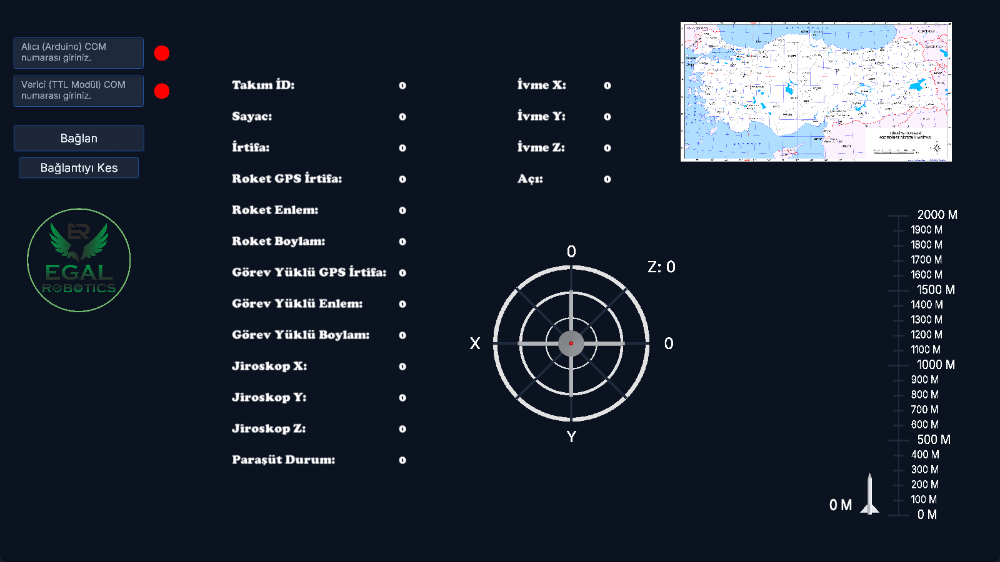
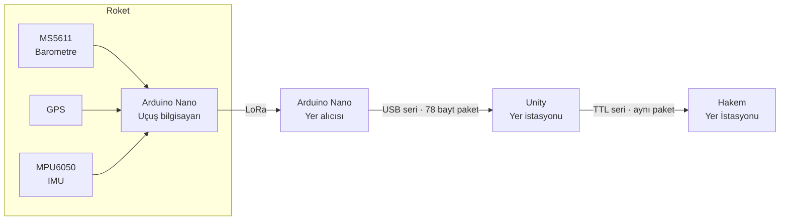

# 🚀 Roket Yer İstasyonu

**LoRa üzerinden roket telemetrisi alan, doğrulayan, görselleştiren ve hakem yer istasyonuna aktaran yer kontrol yazılımı + uçuş bilgisayarı firmware'i**

## Proje hakkında
EGAL Robotics takımı için TEKNOFEST Roket Yarışması kapsamında geliştirdim. Roketteki uçuş bilgisayarı şu verileri toplar:
- barometrik irtifa,
- GPS konumu,
- IMU yönelimi ve ivmesi.

Bu veriler LoRa ile yere gönderilir. Yer istasyonu uygulaması gelen paketi checksum ile doğrular ve tüm değerleri canlı olarak gösterir. Ardından paketi yarışmanın istediği formatta **hakem yer istasyonuna** (HYİ) iletir.

## Özellikler
- **Uçuş bilgisayarı (Arduino Nano)**
  - MS5611 barometre ile kalkış noktasına göre göreli irtifa,
  - GPS (TinyGPS++) ile enlem, boylam ve GPS irtifası,
  - MPU6050 DMP ile yaw/pitch/roll ve ivme,
  - EBYTE E32 LoRa modülü ile kablosuz iletim.
- **Yer alıcısı (Arduino Nano):** LoRa'dan gelen veriyi 78 baytlık, checksum'lı ikili pakete dönüştürüp seri porta yazar.
- **Yer istasyonu (Unity / C#)**
  - Alıcı ve verici (TTL) için iki ayrı COM portu yönetir.
  - Bağlantı durumunu renkle gösterir; hatalı paketleri atar ve uyarı verir.
  - Canlı gösterilenler: irtifa göstergesi (0–2000 m), 3 eksen yönelim göstergesi, roket ve görev yükü konumları, paraşüt durumu.
  - Doğrulanmış paketi hakem yer istasyonuna yeniden iletir.

## Mimari

### Paket yapısı (78 bayt)
| Bayt | Alan | Tip |
|---|---|---|
| 0–3 | Başlık `FF FF 54 52` | sabit |
| 4 | Takım ID | uint8 |
| 5 | Sayaç | uint8 |
| 6–33 | İrtifa, roket GPS irtifa/enlem/boylam, görev yükü GPS irtifa/enlem/boylam | float32 × 7 |
| 34–45 | Kademe GPS irtifa/enlem/boylam | float32 × 3 |
| 46–73 | Jiroskop X/Y/Z, ivme X/Y/Z, açı | float32 × 7 |
| 74 | Paraşüt durumu | uint8 |
| 75 | Checksum: bayt 4–74 toplamının 256'ya göre modu | uint8 |
| 76–77 | Bitiş `0D 0A` | sabit |

## Nasıl denenir
1. [Releases](../../releases) sayfasından `RocketGroundStation-Windows.zip` dosyasını indirip çıkar.
2. `RocketGroundStation.exe` dosyasını çalıştır.
3. Alıcı Arduino'nun ve TTL modülün COM numaralarını yazıp **Bağlan**'a bas.

> Donanım bağlı değilse arayüz açılır ama veri akmaz. Portlar kırmızı gösterilir ve hata uyarısı çıkar.

## Kod örnekleri
Projenin tamamı paylaşılmamıştır. Öne çıkan parçalar [`showcase/`](showcase) klasöründedir:
- [`firmware/roket_panel_verici/`](showcase/firmware/roket_panel_verici): sensör okuma ve LoRa iletimi.
- [`firmware/roket_panel_alici/paket_olustur.ino`](showcase/firmware/roket_panel_alici/paket_olustur.ino): float → bayt dönüşümü ve checksum.
- [`unity/arduino_connect.cs`](showcase/unity/arduino_connect.cs): seri port yönetimi, paket doğrulama ve HYİ'ye aktarım.

## Neler öğrendim
- İkili protokol tasarımı: union ile float32 → bayt dönüşümü, endianness, checksum.
- İki seri portu eşzamanlı yönetme ve hatalı paketlerden kurtulma.
- Gerçek zamanlı telemetrinin okunabilir bir arayüzle sunulması.

---
© Ahmet Emin Arslanbaş — Tüm hakları saklıdır. Kod inceleme amaçlı paylaşılmıştır.
